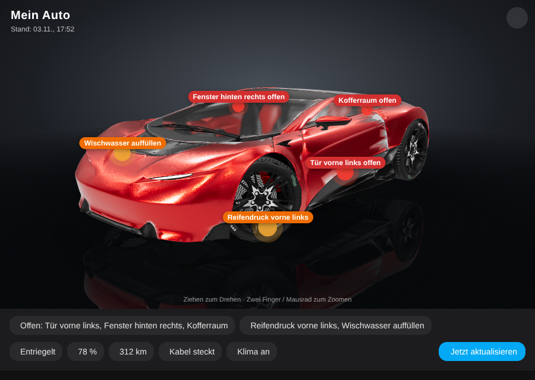
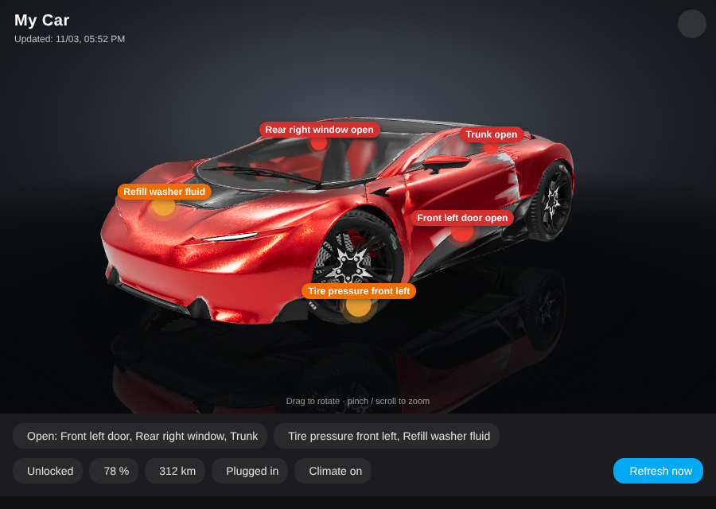
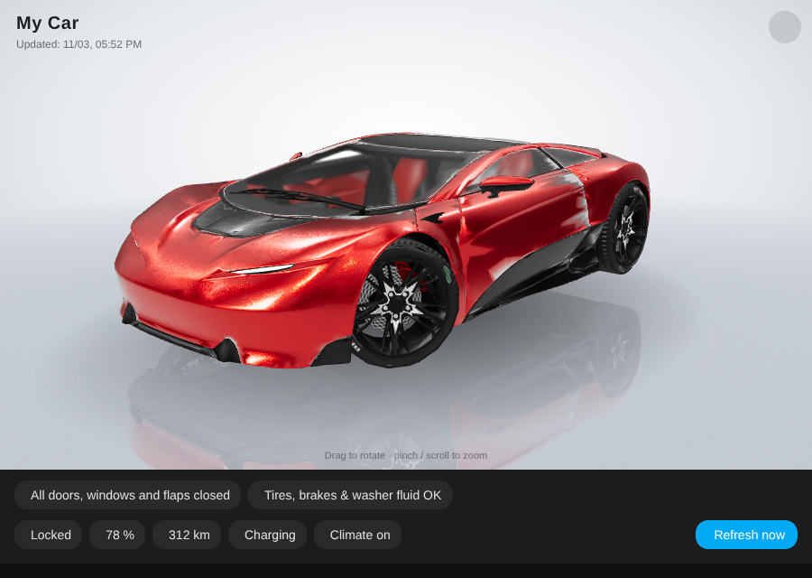
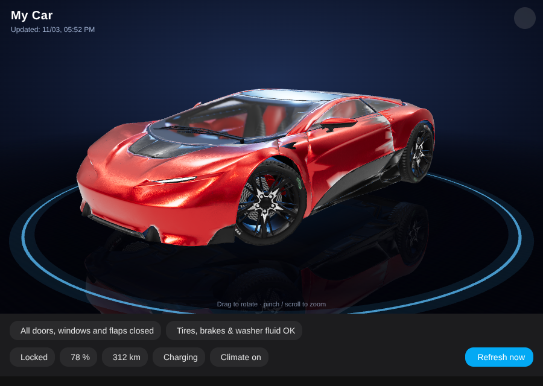

# Car 3D Card für Home Assistant

🇬🇧 [English version](README.md)

Zeigt **dein eigenes Auto als drehbares 3D-Modell** im Home-Assistant-Dashboard: ziehen zum Drehen, zwei Finger oder
Mausrad zum Zoomen. Der **Live-Status** erscheint direkt am Modell:

- 🔴 **Offene Türen, Fenster, Schiebedach, Kofferraum, Motorhaube und Ladeklappe** pulsieren rot an der richtigen Stelle
- 🟠 **Warnungen** (Reifendruck je Rad, Bremsflüssigkeit, Wischwasser) pulsieren orange
- 🔒 Verriegelung, 🔋 Akku bzw. ⛽ Tank, Reichweite, Laden / Kabel steckt, Klima, Front- und Heckscheibenheizung
- 🔄 Optionaler Knopf „Jetzt aktualisieren“, der das Auto weckt und frische Daten holt
- 🎨 Drei Hintergründe (Showroom dunkel, Showroom hell, Nacht mit Neon-Ring) mit Bodenspiegelung, umschaltbar per Tipp
- 📦 **Eigenes 3D-Modell** (GLB) einbinden, oder direkt mit dem eingebauten Demo-Auto starten
- 🌍 Deutsch und Englisch, richtet sich nach der Sprache in Home Assistant



| Showroom dunkel | Showroom hell | Nacht |
|---|---|---|
|  |  |  |

<sub>Die Screenshots zeigen das Modell [Car Concept](https://github.com/KhronosGroup/glTF-Sample-Assets/tree/main/Models/CarConcept)
von Eric Chadwick / Darmstadt Graphics Group GmbH, Lizenz [CC BY 4.0](https://creativecommons.org/licenses/by/4.0/deed.de)
(für die Screenshots mit verkleinerten Texturen und vereinfachter Geometrie). Das Modell ist **nicht** Teil dieses Repos.
Die Icons erscheinen in Home Assistant, fehlen aber in diesen Offline-Renderings.</sub>

Ohne eigenes Modell zeigt die Karte ein schlichtes **Demo-Auto**. So kannst du zuerst die Sensoren einrichten.

---

## Voraussetzungen

- Home Assistant 2024.1 oder neuer
- Ein Browser mit WebGL (alle aktuellen Browser und die Companion-App)
- Internet im Browser: Die 3D-Engine [three.js](https://threejs.org) wird über das jsDelivr-CDN geladen
- Eine Auto-Integration, die die Sensoren unten bereitstellt, z. B. **Kia UVO / Hyundai Bluelink** (`kia_uvo`). Damit
  reicht `prefix:`. Andere Integrationen (Tesla, BMW, Mercedes, VW, Renault, …) funktionieren, indem man die Entitäten
  einzeln zuordnet. **Jeder Sensor ist optional**, was fehlt, wird einfach ausgeblendet.

### Sensoren

| Schlüssel | Anzeige | Erwartete Entität / Zustand | Kia / Hyundai Standard (`prefix: ev6`) |
|---|---|---|---|
| `front_left_door` / `front_right_door` | roter Marker + Liste | `binary_sensor`, `on` = offen | `binary_sensor.ev6_front_left_door` / `…_front_right_door` |
| `rear_left_door` / `rear_right_door` | roter Marker + Liste | `binary_sensor`, `on` = offen | `binary_sensor.ev6_back_left_door` / `…_back_right_door` |
| `front_left_window` / `front_right_window` | roter Marker + Liste | `binary_sensor`, `on` = offen | `binary_sensor.ev6_front_left_window` / `…_front_right_window` |
| `rear_left_window` / `rear_right_window` | roter Marker + Liste | `binary_sensor`, `on` = offen | `binary_sensor.ev6_back_left_window` / `…_back_right_window` |
| `sunroof` | roter Marker + Liste | `binary_sensor`, `on` = offen | `binary_sensor.ev6_sunroof` |
| `trunk` | roter Marker + Liste | `binary_sensor`, `on` = offen | `binary_sensor.ev6_trunk` |
| `hood` | roter Marker + Liste | `binary_sensor`, `on` = offen | `binary_sensor.ev6_hood` |
| `charge_port` | roter Marker + Liste | `binary_sensor`, `on` = offen | `binary_sensor.ev6_ev_charge_port` |
| `tire_front_left` … `tire_rear_right` | oranger Marker | `binary_sensor`, `on` = Druck zu niedrig | `binary_sensor.ev6_tire_pressure_front_left` … `…_rear_right` |
| `brake_fluid` | oranger Marker | `binary_sensor`, `on` = Warnung | `binary_sensor.ev6_brake_fluid_warning` |
| `washer_fluid` | oranger Marker | `binary_sensor`, `on` = Warnung | `binary_sensor.ev6_washer_fluid_warning` |
| `lock` | Chip | `lock`, `locked` / `unlocked` | `lock.ev6_door_lock` |
| `battery` | Chip | `sensor`, % | `sensor.ev6_ev_battery_level` |
| `range` | Chip | `sensor` mit Einheit | `sensor.ev6_ev_range` |
| `fuel_level` / `fuel_range` | Chip | `sensor` (Verbrenner / Hybrid) | `sensor.ev6_fuel_level` / `sensor.ev6_fuel_driving_range` |
| `plug` | Chip | `binary_sensor`, `on` = Kabel steckt | `binary_sensor.ev6_ev_battery_plug` |
| `charging` | Chip | `binary_sensor`, `on` = lädt | `binary_sensor.ev6_ev_battery_charge` |
| `climate` | Chip | `binary_sensor`, `on` = Klima läuft | `binary_sensor.ev6_air_conditioner` |
| `defrost` / `rear_defrost` | Chip | `binary_sensor`, `on` = heizt | `binary_sensor.ev6_defrost` / `binary_sensor.ev6_back_window_heater` |
| `updated` | Zeile „Stand: …“ | `sensor` mit Zeitstempel | `sensor.ev6_last_updated_at` |
| `refresh` | Knopf „Jetzt aktualisieren“ | `button` | `button.ev6_force_refresh` |

> Ersetze `ev6` durch den Namen **deines** Autos in Home Assistant. Schau dir eine beliebige Entität des Autos an, z. B.
> `lock.mein_auto_door_lock` → `prefix: mein_auto`.

---

## Installation

### HACS (empfohlen)

1. HACS → ⋮ (oben rechts) → **Benutzerdefinierte Repositories**
2. Repository: `https://github.com/thisislennard/ha-car-3d-card`, Typ: **Dashboard** → **Hinzufügen**
3. Nach **Car 3D Card** suchen → **Herunterladen**
4. Browser neu laden (am Handy: Companion-App → Einstellungen → Fehlersuche → *Frontend-Cache zurücksetzen*)

### Manuell

1. `car-3d-card.js` aus diesem Repo herunterladen und nach `/config/www/car-3d-card.js` kopieren
2. Einstellungen → Dashboards → ⋮ → **Ressourcen** → **Ressource hinzufügen**:
   URL `/local/car-3d-card.js?v=1`, Typ **JavaScript-Modul**
3. Browser neu laden

---

## Konfiguration

### Minimal – Kia / Hyundai

```yaml
type: custom:car-3d-card
prefix: ev6
title: Mein Auto
```

### Mit eigenem 3D-Modell

```yaml
type: custom:car-3d-card
prefix: ev6
title: Mein Auto
model: /local/car3d/mein-auto.glb
model_length: 4.70        # echte Länge des Autos in Metern, das Modell wird darauf skaliert
```

### Andere Integrationen – Entitäten selbst zuordnen

```yaml
type: custom:car-3d-card
title: Model 3
model: /local/car3d/model3.glb
entities:
  front_left_door: binary_sensor.model3_front_driver_door
  front_right_door: binary_sensor.model3_front_passenger_door
  trunk: binary_sensor.model3_trunk
  hood: binary_sensor.model3_frunk
  charge_port: binary_sensor.model3_charge_port_door
  lock: lock.model3_lock
  battery: sensor.model3_battery_level
  range: sensor.model3_battery_range
  charging: binary_sensor.model3_charging
```

(Die Entitäts-IDs sind Beispiele, nimm die, die deine Integration anlegt.)

Beides lässt sich kombinieren: `prefix:` füllt alles, `entities:` überschreibt einzelne Schlüssel. Mit `null` blendest du
einen Schlüssel aus:

```yaml
prefix: ev6
entities:
  sunroof: null                       # mein Auto hat kein Schiebedach
  updated: sensor.ev6_data_timestamp  # anderer Sensor als der Standard
```

### Alle Optionen

| Option | Standard | Beschreibung |
|---|---|---|
| `title` | – | Text oben links |
| `prefix` | – | Entitäten automatisch nach dem Kia/Hyundai-Schema ableiten (siehe Tabelle) |
| `entities` | – | Zuordnung Schlüssel → Entität, überschreibt `prefix` |
| `model` | – | Pfad zur GLB-Datei, z. B. `/local/car3d/mein-auto.glb`. Ohne Angabe erscheint das Demo-Auto |
| `model_length` | `4.7` | Länge des Autos in Metern. Das Modell wird darauf skaliert, zentriert und auf den Boden gestellt |
| `model_rotation` | `0` | Drehung um die Hochachse in Grad, falls die Front nicht nach vorne zeigt: `90`, `180`, `-90` |
| `markers` | – | Einzelne Marker verschieben, siehe [Marker-Positionen](#marker-positionen) |
| `recolor` | `false` bei eigenen Modellen | `true`: Materialien mit den Namen `paint`, `glass`, `tire`, `rim`, `rim_face`, `brake`, `caliper`, `interior`, `trim`, `trim_gloss`, `chrome`, `headlight`, `drl`, `taillight` werden durch eingebaute ersetzt |
| `paint_color` | `#4f5256` | Lackfarbe beim Umfärben (Metallic-Grau mit Klarlack) |
| `lights` | `true` | Leuchteffekt für Tagfahrlicht (`drl`) und Rückleuchten (`taillight`) – benötigt `recolor` |
| `background` | `studio` | Start-Hintergrund: `studio`, `light` oder `night`. Jeder Browser merkt sich die letzte Wahl per 🎨 |
| `reflection` | `true` | Spiegelung im Boden (`false` = etwas schneller auf alten Handys) |
| `auto_rotate` | `true` | Auto dreht sich langsam; stoppt beim Anfassen und läuft nach 20 s weiter |
| `height` | `62vh` | Höhe der 3D-Fläche (jede CSS-Höhe, z. B. `500px`) |

Tipp: Eine **Panel-Ansicht** mit `vertical-stack` passt gut. Oben das 3D-Modell, darunter Regler, z. B. das Ladelimit:

```yaml
type: panel
cards:
  - type: vertical-stack
    cards:
      - type: custom:car-3d-card
        prefix: ev6
        model: /local/car3d/mein-auto.glb
      - type: tile
        entity: number.ev6_ac_charging_limit
        features:
          - type: numeric-input
            style: slider
```

---

## Eigenes 3D-Modell

Die Karte lädt jede **glTF-Binärdatei (`.glb`)**. Gute Quellen:

- **Sketchfab** – viele detaillierte Automodelle. ⚠️ Lizenz auf der Modellseite prüfen: **CC BY / CC0** darf weitergegeben
  werden (mit Namensnennung). Modelle mit „Standard“- oder „Editorial“-Lizenz dürfen **nicht** weitergegeben werden. Ob du
  ein gekauftes oder heruntergeladenes Modell in deinem privaten Dashboard nutzen darfst, regelt seine Lizenz. Solche
  Dateien gehören nie in ein öffentliches Repo.
- Eigene Scans oder Blender-Modelle.

### 1. In GLB umwandeln

Viele Modelle gibt es als `.usdz`, `.fbx`, `.obj` oder `.blend`. Mit dem kostenlosen [Blender](https://www.blender.org):

1. **Datei → Importieren** (USD für `.usdz`, FBX, OBJ, …)
2. Alles löschen, was nicht zum Auto gehört (Bodenplatte, Hintergrund, Lichter, Kameras)
3. **Datei → Exportieren → glTF 2.0** → Format **glTF Binary (.glb)**, *Modifikatoren anwenden* aktivieren

### 2. Klein und schnell machen (empfohlen)

Handys kommen mit Dateien unter ca. 5 MB gut zurecht. Komprimieren mit [glTF Transform](https://gltf-transform.dev)
(braucht [Node.js](https://nodejs.org)):

```bash
npx @gltf-transform/cli optimize mein-auto.glb mein-auto-klein.glb --compress meshopt --texture-size 1024
```

Die Karte unterstützt Meshopt- und Draco-Kompression.

### 3. In Home Assistant hochladen

Die Datei nach `/config/www/car3d/mein-auto.glb` kopieren, z. B. mit der App **File editor** (Ordner-Symbol → `www` →
Ordner `car3d` anlegen → hochladen), per **Samba-Freigabe** oder mit **Studio Code Server**. Dateien in `/config/www`
sind unter `/local/…` erreichbar, also:

```yaml
model: /local/car3d/mein-auto.glb
```

Nach dem Austauschen der Datei eine Version anhängen, damit der Browser nicht die alte zwischengespeicherte nimmt:
`model: /local/car3d/mein-auto.glb?v=2`

### 4. Ausrichtung und Größe prüfen

- Die **Front** des Autos sollte beim Start nach unten links zeigen, wie auf den Screenshots. Sonst
  `model_rotation: 90`, `180` oder `-90` setzen.
- `model_length` auf die echte Länge des Autos setzen, damit die Marker auf der richtigen Höhe sitzen.

### Marker-Positionen

Marker werden **relativ zur Modellgröße** platziert, die Standardwerte passen daher für die meisten Autos:

- `x`: `-1` = rechte Seite … `+1` = linke Seite
- `y`: `0` = Boden … `1` = Dach
- `z`: `-1` = Heck … `+1` = Front

Sitzt ein Marker bei deinem Modell etwas daneben, verschiebe ihn:

```yaml
markers:
  charge_port: [0.92, 0.58, -0.66]   # Ladeklappe hinten links statt hinten rechts
  front_left_door: [0.96, 0.45, 0.20]
```

Die Standardpositionen stehen in der [englischen README](README.md#marker-positions).

### Umfärben

Heruntergeladene Modelle behalten ihre eigenen Materialien und Farben. Benennst du die Materialien in Blender `paint`,
`glass`, `tire`, `rim`, `rim_face`, `brake`, `caliper`, `interior`, `trim`, `trim_gloss`, `chrome`, `headlight`, `drl` und `taillight`, kann die Karte eigene Materialien verwenden und
du wählst die Lackfarbe:

```yaml
recolor: true
paint_color: "#1d3557"
```

---

## Häufige Fragen

**Die Karte zeigt „Custom element doesn't exist: car-3d-card“.**
Die Ressource ist noch nicht geladen. Einstellungen → Dashboards → Ressourcen prüfen, Browser neu laden bzw.
Frontend-Cache zurücksetzen.

**„3D-Modell konnte nicht geladen werden: … 404“.**
Die Datei liegt nicht unter diesem Pfad. `/local/…` zeigt auf `/config/www/…`. Schreibweise und Ordner prüfen.

**Wischen auf dem Auto wechselt die Dashboard-Seite.**
Gesten auf der 3D-Fläche werden nicht weitergegeben, Wischen auf dem Auto dreht also nur das Auto. Zum Seitenwechsel
unterhalb des Autos wischen.

**Verlassen Daten mein Home Assistant?**
Nein. Nur three.js wird vom jsDelivr-CDN geladen. Dein Modell und deine Sensorwerte bleiben in deinem Browser.

**Die Werte ändern sich nur alle 30–60 Minuten.**
Das liegt an der Cloud-Integration des Autos, nicht an der Karte. Der Knopf „Jetzt aktualisieren“ (`refresh`) weckt das
Auto und fragt frische Daten ab. Sparsam nutzen, er kostet etwas 12-V-Batterie.

---

## Lizenz

[MIT](LICENSE) – 3D-Engine: [three.js](https://threejs.org) (MIT), wird zur Laufzeit geladen.
