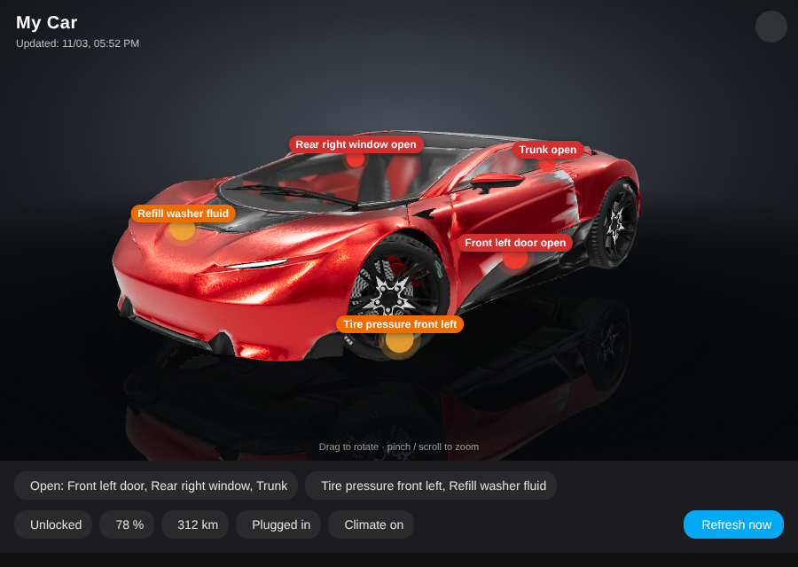
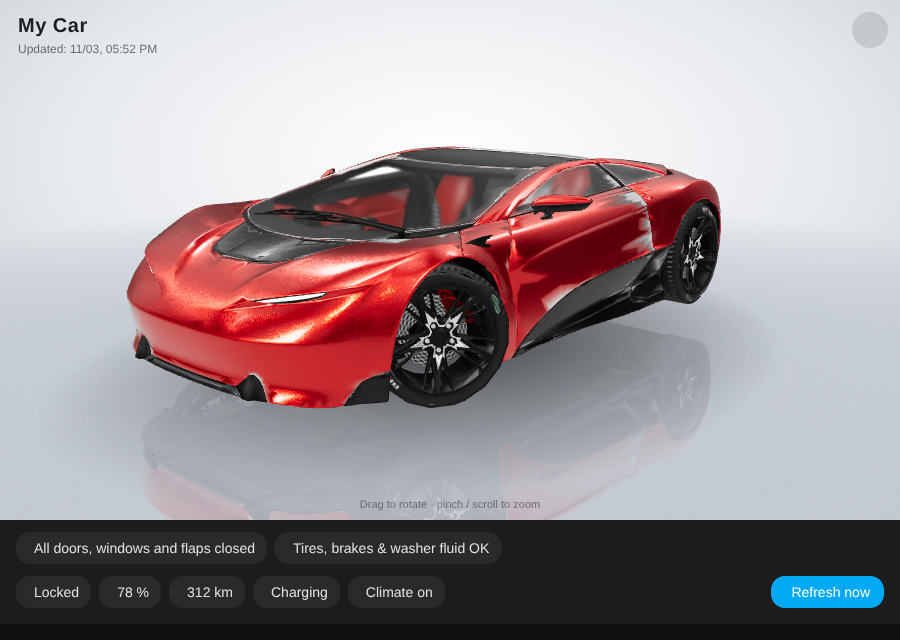
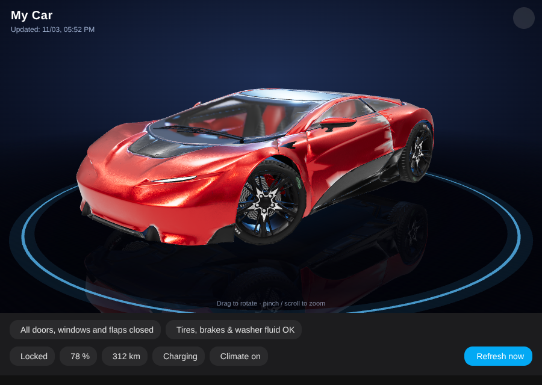
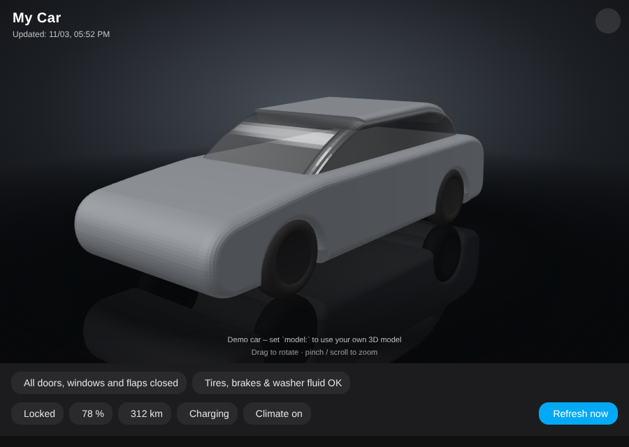

# Car 3D Card for Home Assistant

[](https://hacs.xyz/docs/faq/custom_repositories)


🇩🇪 [Deutsche Anleitung](README.de.md)

Show **your own car as an interactive 3D model** on your Home Assistant dashboard – drag to rotate, pinch or scroll to zoom –
with **live status** right on the model:

- 🔴 **Open doors, windows, sunroof, trunk, hood and charge port** pulse red at the right spot on the car
- 🟠 **Warnings** (tire pressure per wheel, brake fluid, washer fluid) pulse orange
- 🔒 Lock state, 🔋 battery / ⛽ fuel, range, charging / plugged in, climate, windshield and rear window heating
- 🔄 Optional "Refresh now" button to wake the car and fetch fresh data
- 🎨 Three backgrounds (dark showroom, light showroom, night with neon ring) with floor reflection – switch with one tap
- 📦 **Bring your own 3D model** (GLB) – or start right away with the built-in demo car
- 🌍 English and German, follows your Home Assistant language

| Dark showroom | Light showroom | Night |
|---|---|---|
|  |  |  |

<sub>Screenshots use the [Car Concept](https://github.com/KhronosGroup/glTF-Sample-Assets/tree/main/Models/CarConcept) model by
Eric Chadwick / Darmstadt Graphics Group GmbH, licensed [CC BY 4.0](https://creativecommons.org/licenses/by/4.0/) (textures reduced
and geometry simplified for the screenshots). The model is **not** included in this repository. Icons are shown in Home Assistant
but not in these offline renders.</sub>

Without a model the card shows a simple **demo car**, so you can set up your sensors first:



---

## Requirements

- Home Assistant 2024.1 or newer
- A browser with WebGL (all current desktop and mobile browsers, including the Companion app)
- Internet access in the browser: the 3D engine [three.js](https://threejs.org) is loaded from the jsDelivr CDN
- A car integration that exposes the sensors below – e.g. **Kia UVO / Hyundai Bluelink** (`kia_uvo`), which works
  out of the box with `prefix:`. Other integrations (Tesla, BMW, Mercedes, VW, Renault, …) work by mapping the entities
  manually. **Every sensor is optional** – whatever you don't have is simply hidden.

### Sensors

| Key | Shown as | Expected entity / state | Kia / Hyundai default (`prefix: ev6`) |
|---|---|---|---|
| `front_left_door` / `front_right_door` | red marker + list | `binary_sensor`, `on` = open | `binary_sensor.ev6_front_left_door` / `…_front_right_door` |
| `rear_left_door` / `rear_right_door` | red marker + list | `binary_sensor`, `on` = open | `binary_sensor.ev6_back_left_door` / `…_back_right_door` |
| `front_left_window` / `front_right_window` | red marker + list | `binary_sensor`, `on` = open | `binary_sensor.ev6_front_left_window` / `…_front_right_window` |
| `rear_left_window` / `rear_right_window` | red marker + list | `binary_sensor`, `on` = open | `binary_sensor.ev6_back_left_window` / `…_back_right_window` |
| `sunroof` | red marker + list | `binary_sensor`, `on` = open | `binary_sensor.ev6_sunroof` |
| `trunk` | red marker + list | `binary_sensor`, `on` = open | `binary_sensor.ev6_trunk` |
| `hood` | red marker + list | `binary_sensor`, `on` = open | `binary_sensor.ev6_hood` |
| `charge_port` | red marker + list | `binary_sensor`, `on` = open | `binary_sensor.ev6_ev_charge_port` |
| `tire_front_left` … `tire_rear_right` | orange marker | `binary_sensor`, `on` = low pressure | `binary_sensor.ev6_tire_pressure_front_left` … `…_rear_right` |
| `brake_fluid` | orange marker | `binary_sensor`, `on` = warning | `binary_sensor.ev6_brake_fluid_warning` |
| `washer_fluid` | orange marker | `binary_sensor`, `on` = warning | `binary_sensor.ev6_washer_fluid_warning` |
| `lock` | chip | `lock`, `locked` / `unlocked` | `lock.ev6_door_lock` |
| `battery` | chip | `sensor`, % | `sensor.ev6_ev_battery_level` |
| `range` | chip | `sensor` with unit | `sensor.ev6_ev_range` |
| `fuel_level` / `fuel_range` | chip | `sensor` (combustion / hybrid) | `sensor.ev6_fuel_level` / `sensor.ev6_fuel_driving_range` |
| `plug` | chip | `binary_sensor`, `on` = plugged in | `binary_sensor.ev6_ev_battery_plug` |
| `charging` | chip | `binary_sensor`, `on` = charging | `binary_sensor.ev6_ev_battery_charge` |
| `climate` | chip | `binary_sensor`, `on` = climate running | `binary_sensor.ev6_air_conditioner` |
| `defrost` / `rear_defrost` | chip | `binary_sensor`, `on` = heating | `binary_sensor.ev6_defrost` / `binary_sensor.ev6_back_window_heater` |
| `updated` | "Updated: …" line | `sensor` with a timestamp | `sensor.ev6_last_updated_at` |
| `refresh` | "Refresh now" button | `button` | `button.ev6_force_refresh` |

> Replace `ev6` with the name of **your** car in Home Assistant – look at any entity of the car, e.g.
> `lock.my_car_door_lock` → `prefix: my_car`.

---

## Installation

### HACS (recommended)

1. HACS → ⋮ (top right) → **Custom repositories**
2. Repository: `https://github.com/thisislennard/ha-car-3d-card`, type: **Dashboard** → **Add**
3. Search for **Car 3D Card** → **Download**
4. Reload the browser (on the phone: Companion app → Settings → Debugging → *Reset frontend cache*)

### Manual

1. Download `car-3d-card.js` from this repository and copy it to `/config/www/car-3d-card.js`
2. Settings → Dashboards → ⋮ → **Resources** → **Add resource**:
   URL `/local/car-3d-card.js?v=1`, type **JavaScript module**
3. Reload the browser

---

## Configuration

### Minimal – Kia / Hyundai

```yaml
type: custom:car-3d-card
prefix: ev6
title: My Car
```

### With your own 3D model

```yaml
type: custom:car-3d-card
prefix: ev6
title: My Car
model: /local/car3d/my-car.glb
model_length: 4.70        # real length of your car in metres – the model is scaled to it
```

### Any other integration – map the entities yourself

```yaml
type: custom:car-3d-card
title: Model 3
model: /local/car3d/model3.glb
entities:
  front_left_door: binary_sensor.model3_front_driver_door
  front_right_door: binary_sensor.model3_front_passenger_door
  rear_left_door: binary_sensor.model3_rear_driver_door
  rear_right_door: binary_sensor.model3_rear_passenger_door
  trunk: binary_sensor.model3_trunk
  hood: binary_sensor.model3_frunk
  charge_port: binary_sensor.model3_charge_port_door
  lock: lock.model3_lock
  battery: sensor.model3_battery_level
  range: sensor.model3_battery_range
  charging: binary_sensor.model3_charging
```

(The entity ids are examples – use the ones your integration creates.)

You can combine both: `prefix:` fills everything, and `entities:` overrides single keys. Set a key to `null` to hide it:

```yaml
prefix: ev6
entities:
  sunroof: null                       # my car has no sunroof
  updated: sensor.ev6_data_timestamp  # different sensor than the default
```

### All options

| Option | Default | Description |
|---|---|---|
| `title` | – | Text in the top left corner |
| `prefix` | – | Derive all entities from the Kia / Hyundai naming scheme (see table above) |
| `entities` | – | Map of key → entity id, overrides `prefix` (see table above) |
| `model` | – | URL of your GLB file, e.g. `/local/car3d/my-car.glb`. Without it the demo car is shown |
| `model_length` | `4.7` | Length of the car in metres. The model is scaled to this, centred and placed on the floor |
| `model_rotation` | `0` | Rotate the model around the vertical axis (degrees) if its front doesn't face forward: `90`, `180`, `-90` |
| `markers` | – | Move single markers, see [Marker positions](#marker-positions) |
| `recolor` | `false` for own models | `true`: replace materials named `paint`, `glass`, `tire`, `rim`, `rim_face`, `brake`, `caliper`, `interior`, `trim`, `trim_gloss`, `chrome`, `headlight`, `drl`, `taillight` with built-in ones |
| `paint_color` | `#4f5256` | Paint colour when recolouring (metallic grey with clear coat) |
| `lights` | `true` | Glow effect for headlight LED elements (`drl`) and tail lights (`taillight`) – needs `recolor` |
| `background` | `studio` | Default background: `studio`, `light` or `night`. Each browser remembers the last one picked with 🎨 |
| `reflection` | `true` | Mirror the car in the floor (`false` = slightly faster on old phones) |
| `auto_rotate` | `true` | Slowly rotate the car; stops while you touch it and resumes after 20 s |
| `height` | `62vh` | Height of the 3D area (any CSS height, e.g. `500px`) |

Tip: a **panel view** with a vertical stack works great – the 3D model on top, sliders (e.g. charge limit) below:

```yaml
type: panel
cards:
  - type: vertical-stack
    cards:
      - type: custom:car-3d-card
        prefix: ev6
        model: /local/car3d/my-car.glb
      - type: tile
        entity: number.ev6_ac_charging_limit
        features:
          - type: numeric-input
            style: slider
```

---

## Your own 3D model

The card loads any **glTF binary (`.glb`)** file. Good sources:

- **Sketchfab** – many detailed car models. ⚠️ Check the license on the model page: **CC BY / CC0** may be shared
  (keep the attribution); models under "Standard" or "Editorial" licenses must **not** be redistributed. Using a model
  you bought or downloaded on your own private dashboard is up to its license – never commit such files to a public repository.
- Your own scans or Blender models.

### 1. Convert to GLB

Many models come as `.usdz`, `.fbx`, `.obj` or `.blend`. With the free [Blender](https://www.blender.org):

1. **File → Import** (USD for `.usdz`, FBX, OBJ, …)
2. Delete anything that isn't the car (ground plane, background, lights, cameras)
3. **File → Export → glTF 2.0** → format **glTF Binary (.glb)**, enable *Apply Modifiers*

### 2. Make it small and fast (recommended)

Phones are happy with files below ~5 MB. Compress with [glTF Transform](https://gltf-transform.dev)
(needs [Node.js](https://nodejs.org)):

```bash
npx @gltf-transform/cli optimize my-car.glb my-car-small.glb --compress meshopt --texture-size 1024
```

Meshopt and Draco compression are both supported by the card.

### 3. Upload to Home Assistant

Copy the file to `/config/www/car3d/my-car.glb` – for example with the **File editor** app (folder icon → `www` →
create folder `car3d` → upload), **Samba share** or **Studio Code Server**. Files in `/config/www` are served as
`/local/…`, so the card option is:

```yaml
model: /local/car3d/my-car.glb
```

After replacing the file, add a version so browsers don't use the old cached one: `model: /local/car3d/my-car.glb?v=2`

### 4. Check orientation and size

- The **front** of the car should point to the bottom left when the card starts (like in the screenshots).
  Otherwise use `model_rotation: 90`, `180` or `-90`.
- Set `model_length` to the real length of your car so the markers sit at the right height.

### Marker positions

Markers are placed **relative to the size of the model**, so the defaults fit most cars:

- `x`: `-1` = right side … `+1` = left side
- `y`: `0` = ground … `1` = roof
- `z`: `-1` = rear … `+1` = front

If a marker is slightly off on your model, move it:

```yaml
markers:
  charge_port: [0.92, 0.58, -0.66]   # charge port on the left rear instead of right rear
  front_left_door: [0.96, 0.45, 0.20]
```

Default positions:

| Key | Default `[x, y, z]` | | Key | Default `[x, y, z]` |
|---|---|---|---|---|
| `front_left_door` | `[0.96, 0.50, 0.15]` | | `trunk` | `[0, 0.69, -1.02]` |
| `front_right_door` | `[-0.96, 0.50, 0.15]` | | `hood` | `[0, 0.60, 0.70]` |
| `rear_left_door` | `[0.96, 0.50, -0.30]` | | `charge_port` | `[-0.92, 0.58, -0.66]` |
| `rear_right_door` | `[-0.96, 0.50, -0.30]` | | `tire_front_left` | `[0.85, 0.24, 0.60]` |
| `front_left_window` | `[0.79, 0.78, 0.13]` | | `tire_front_right` | `[-0.85, 0.24, 0.60]` |
| `front_right_window` | `[-0.79, 0.78, 0.13]` | | `tire_rear_left` | `[0.85, 0.24, -0.64]` |
| `rear_left_window` | `[0.79, 0.78, -0.28]` | | `tire_rear_right` | `[-0.85, 0.24, -0.64]` |
| `rear_right_window` | `[-0.79, 0.78, -0.28]` | | `brake_fluid` | `[0.39, 0.61, 0.58]` |
| `sunroof` | `[0, 0.99, 0.0]` | | `washer_fluid` | `[-0.39, 0.61, 0.75]` |

### Recolouring

Most downloaded models keep their own materials and colours. If you name the materials of your model in Blender
`paint`, `glass`, `tire`, `rim`, `rim_face`, `brake`, `caliper`, `interior`, `trim`, `trim_gloss`, `chrome`, `headlight` (clear lens), `drl` (glowing LEDs) and `taillight`, you can let the card apply its
materials and choose the paint colour:

```yaml
recolor: true
paint_color: "#1d3557"
```

---

## FAQ

**The card shows "Custom element doesn't exist: car-3d-card".**
The resource isn't loaded yet – check Settings → Dashboards → Resources and reload the browser / reset the frontend cache.

**"3D model could not be loaded: … 404".**
The file isn't at that path. `/local/…` points to `/config/www/…`. Check the spelling and the folder.

**Swiping on the car changes the dashboard page.**
Gestures on the 3D area are not passed on, so swiping on the car only rotates it. Swipe below the car to change views.

**Does any data leave my Home Assistant?**
No. Only three.js is downloaded from the jsDelivr CDN. Your model and your sensor values stay in your browser.

**My values only update every 30–60 minutes.**
That's the car's cloud integration, not the card. The "Refresh now" button (`refresh`) wakes the car and requests
fresh data – use it sparingly, it uses a little 12 V battery.

---

## License

[MIT](LICENSE) – 3D engine: [three.js](https://threejs.org) (MIT), loaded at runtime.
